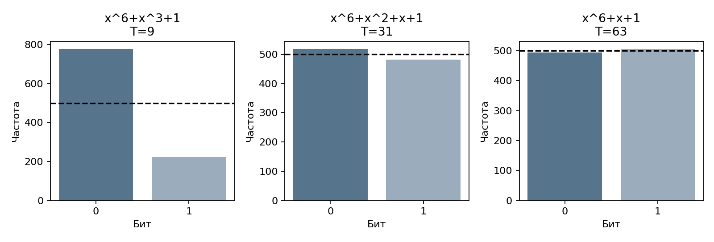
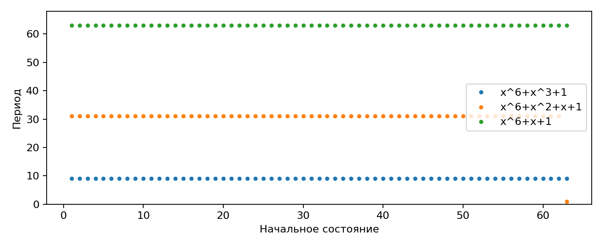

# Лабораторная работа №1. Вариант 7

## Цель и задание

Реализовать генератор LFSR для трёх многочленов варианта, исследовать периоды и равномерность выходных битов. Реализовать метод Михалеску для построения доказуемо простых чисел при e=1/3. Объединить оба этапа в консольное приложение.

## 1. Генератор LFSR

Регистр содержит шесть двоичных ячеек. В соответствии с формулой (8) методички (с.36) выходом служит S₀(t), ячейки сдвигаются, а новый старший бит вычисляется как сумма выбранных битов по модулю 2:

- Sᵢ(t+1)=Sᵢ₊₁(t), i=0,…,4;
- S₅(t+1)=ΣaⱼSⱼ(t) mod 2.

Сложение по модулю 2 реализовано операцией XOR. S₀ хранится в младшем бите состояния.

| Обозначение | Многочлен | Обратная связь |
|---|---|---|
| f₁ | x⁶+x³+1 | S₀ XOR S₃ |
| f₂ | x⁶+x²+x+1 | S₀ XOR S₁ XOR S₂ |
| f₃ | x⁶+x+1 | S₀ XOR S₁ |

Теоретический максимальный период для примитивного многочлена степени 6 равен Tmax=2⁶−1=63. Для каждого многочлена перебраны все 63 ненулевых начальных состояния. Период определяется по первому повторению полного состояния регистра.

| Многочлен | Максимальный найденный период | Примитивность над GF(2) |
|---|---|---|
| f₁ | 9 | Нет |
| f₂ | 31 | Нет |
| f₃ | 63 | Да |

Только f₃ обеспечивает полный цикл из 63 состояний при любом ненулевом начальном состоянии. Основные параметры: f(x)=x⁶+x+1, начальное состояние 1, то есть 000001. Первые 12 выходов: [1,0,0,0,0,0,1,0,0,0,0,1].

Нулевое состояние проверяется отдельно: оно остаётся нулевым при любом из трёх многочленов, поэтому период равен 1. Для рабочей последовательности оно не подходит.

## 2. Статистическое исследование

Каждая выборка содержит L=1000 битов. Подсчитываются частоты n₀ и n₁. Среднее M=n₁/L; дисперсия D=M(1−M). Для равновероятных нуля и единицы теоретические значения: M=0.5, D=0.25.

Критерий Пирсона:

χ²=(n₀−L/2)²/(L/2)+(n₁−L/2)²/(L/2).

H₀ — вероятности нуля и единицы равны 1/2. Порог 3.841459 при α=0.05 и одной степени свободы. При χ² выше порога H₀ отвергается. Для ожидаемой частоты не менее 5 требуется L≥10.


| Многочлен | Начальное состояние | Период | Нули | Единицы | χ² | Результат |
|---|---|---|---|---|---|---|
| f₁ | 1 | 9 | 777 | 223 | 306.916 | H₀ отвергается |
| f₁ | 21 | 9 | 333 | 667 | 111.556 | H₀ отвергается |
| f₁ | 63 | 9 | 333 | 667 | 111.556 | H₀ отвергается |
| f₁ | 0 | 1 | 1000 | 0 | 1000.000 | H₀ отвергается |
| f₂ | 1 | 31 | 518 | 482 | 1.296 | H₀ не отвергается |
| f₂ | 21 | 31 | 516 | 484 | 1.024 | H₀ не отвергается |
| f₂ | 63 | 1 | 0 | 1000 | 1000.000 | H₀ отвергается |
| f₂ | 0 | 1 | 1000 | 0 | 1000.000 | H₀ отвергается |
| f₃ | 1 | 63 | 494 | 506 | 0.144 | H₀ не отвергается |
| f₃ | 21 | 63 | 493 | 507 | 0.196 | H₀ не отвергается |
| f₃ | 63 | 63 | 492 | 508 | 0.256 | H₀ не отвергается |
| f₃ | 0 | 1 | 1000 | 0 | 1000.000 | H₀ отвергается |





Для основных параметров M=0.506, D=0.249964. Многочлен f₃ даёт максимальный период и близкие частоты нулей и единиц. При f₂ и состоянии 1 частотная проверка также не отвергает H₀, хотя период меньше максимального. Следовательно, равные частоты сами по себе не означают большой период или криптостойкость.

## 3. Метод Михалеску

Используется схема раздела 6.10 (с.52–53) с e=1/3. По примечанию таблицы вариантов (с.55) для этого метода стандартная схема формирования кандидатов не требуется. Для выбора параметров применяется отдельный `Random(seed)`, а LFSR исследуется на первом этапе.

Параметры реализации: B=16, c=2, s=1, граница просеивания A=256.

1. Если разрядность m<16, генерируется m-битовое нечётное число и проверяется пробными делениями до ⌊√n⌋. Старший и младший биты устанавливаются в 1.
2. Иначе рекурсивно строится простое F с k=⌈m/3⌉+1 битами. Проверяется условие 2ᵐ<F³<2²ᵐ, равносильное интервалу 2^(m/3)<F<2^(2m/3). Факторизация F известна, поскольку F само является доказанным простым.
3. Выбирается целое t из открытого интервала (2^(m−2)/F, 2^(m−1)/F−sm).
4. Рассматриваются члены прогрессии n=2F(t+i)+1, i=0,…,s. При s=1 проверяются два кандидата. Условия на t обеспечивают требуемую разрядность; нечётность следует из формулы.
5. Выполняется деление на все простые до 256 включительно, последнее из них — 251. Затем выполняются пять раундов Рабина—Миллера.
6. Прошедший кандидат проверяется точным достаточным условием простоты. Если подходящего числа нет, выбираются новые F и t.

### Точное подтверждение простоты

В методичке метод назван генерацией доказуемо простых чисел, однако в описании последним фильтром указан вероятностный тест Рабина—Миллера. Поэтому добавлена точная проверка. 

Для уже доказанного простого F, делящего n−1, ищется свидетель a:

- a^(n−1) ≡ 1 (mod n);
- НОД(a^((n−1)/F)−1,n)=1.

Тогда для каждого простого делителя r числа n порядок a по модулю r кратен F. Следовательно, F делит r−1, то есть r=kF+1. Проверяются все возможные делители такого вида до ⌊√n⌋. Если ни один не делит n, число n простое.

Поскольку F>n^(1/3), количество таких проверок меньше n^(1/6). Для 64-битового числа их не более 1625. Свидетель ищется среди a=2,…,65; если он не найден, кандидат пропускается, а не объявляется простым.

Сертификат содержит n, a и вложенный сертификат простоты F. Рекурсия завершается малым простым, проверяемым пробными делениями. Функция `verify_certificate` повторно проверяет всю цепочку без опоры на результат Рабина—Миллера.

Программа поддерживает разрядность 8–64 бита. Это ограничение реализации для быстрой точной проверки, а не требование методички. `Random(seed)` используется для воспроизводимых учебных экспериментов и не является криптографическим генератором.

## 4. Проверки и фактический запуск

Встроенная самопроверка проверяет:

- первые 12 выходных битов заданного примера LFSR;
- периоды 9, 31, 63 и неподвижность нулевого состояния;
- результаты Рабина—Миллера для чисел 2…999 в сравнении с пробными делениями;
- достаточное условие на числах n=2Fk+1<2000 при F=2,3,5,7,11,13;
- разрядность и сертификаты сгенерированных чисел на 8, 16, 32 и 64 бита.

Результат: `Самопроверка: OK`.

Ниже — фрагмент сохранённого вывода основного запуска с length=1000, bits=64, seed=7. Полный вывод находится в `results/run.txt`. При тех же параметрах числа воспроизводятся; время зависит от компьютера.

```text
Вариант 7. Длина=1000; разрядность=64; seed=7
x^6+x^3+1; state=1; T=9; 0: 777, 1: 223; chi2=306.916000; H0 отвергается
x^6+x^2+x+1; state=1; T=31; 0: 518, 1: 482; chi2=1.296000; H0 не отвергается
x^6+x+1; state=1; T=63; 0: 494, 1: 506; chi2=0.144000; H0 не отвергается
Простое число: 18111118989447328183
Битов: 64
Сертификат простоты: OK
Всего кандидатов на всех уровнях: 622
```

Счётчики сохранённого запуска:

| Показатель | Верхний вызов, 64 бита | Все рекурсивные вызовы |
|---|---|---|
| Проверено кандидатов | 68 | 622 |
| Отсеяно малыми простыми | 50 | 224 |
| Отсеяно Рабином—Миллером | 17 | 31 |
| Не получен сертификат после фильтров | 0 | 0 |
| Отсеяно пробными делениями в базовых вызовах | 0 | 211 |
| Перезапусков прогрессии | 33 | 120 |

Время верхнего вызова в сохранённом запуске: 0.001905 с. Оно включает рекурсивные вызовы, поэтому времена строк `results/prime_log.csv` не суммируются. Счётчики кандидатов и отсевов локальные для каждого вызова, их суммировать можно. Верхний уровень отсеял малыми простыми 50 из 68 кандидатов, то есть 73.53%.

Цепочка сертификата:

| n | Простое F | Свидетель a |
|---|---|---|
| 18111118989447328183 | 8147987 | 2 |
| 8147987 | 337 | 2 |

Простота 337 проверена пробными делениями. Полный сертификат записан в `results/certificate.json`.

## 5. Ключевые фрагменты

Шаг LFSR по формуле (8):

```python
bit = self.state & 1
feedback = 0
for j in self.taps:
    feedback ^= (self.state >> j) & 1
self.state = (self.state >> 1) | (feedback << 5)
return bit
```

Выбор t и построение прогрессии после получения F:

```python
low = 2**(m - 2) // F + 1
high = (2**(m - 1) - 1) // F - s * m
if low > high:
    counts['restarts'] += 1
    continue
t = rng.randint(low, high)
for i in range(s + 1):
    n = 2 * F * (t + i) + 1
```

Точная проверка при известном простом F, делящем n−1:

```python
if pow(a, n - 1, n) != 1:
    return False
if gcd(pow(a, (n - 1) // F, n) - 1, n) != 1:
    return False
return all(n % (k * F + 1)
           for k in range(1, (isqrt(n) - 1) // F + 1))
```

Полный код — `main.py`.

## Запуск

Из папки с `main.py` на Windows:

```console
py -m pip install -r requirements.txt
py main.py --self-test
py main.py
```

На macOS/Linux вместо `py` используется `python3`. 

Результаты записываются в `results`. Запуск с `--no-plots` выполняет расчёты без построения графиков и не требует matplotlib.

## Вывод

Реализованы LFSR для трёх многочленов варианта 7 и метод Михалеску при e=1/3. Максимальный период 63 достигается для x⁶+x+1 при любом ненулевом начальном состоянии. Эксперименты показали влияние многочлена и начального состояния на период и частоты битов. Построено 64-битовое простое число, выполнены просеивание и точная проверка сертификата. Сохранены графики, таблицы, время и количество отсеянных кандидатов.
