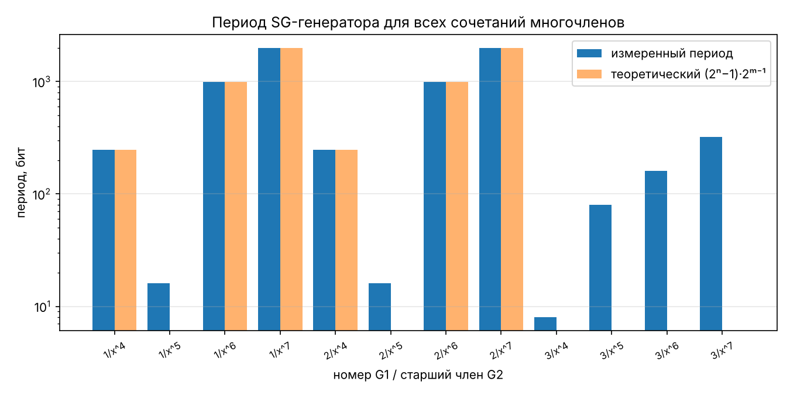
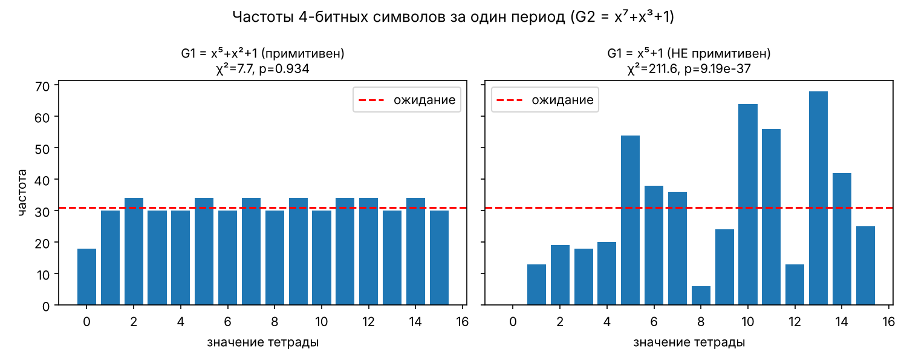
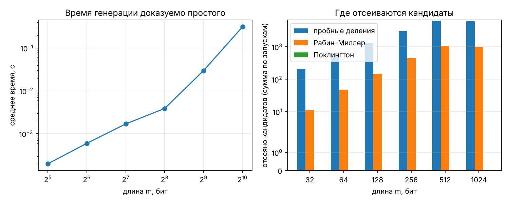

# Лабораторная работа №1. Вариант 10

**Дисциплина:** «Криптография и сетевая безопасность», БрГТУ, кафедра ИИТ  
**Тема:** исследование алгоритмов генерации псевдослучайных последовательностей и методов тестирования чисел на простоту  
**Выполнил:** студент 4 курса группы АС-65 Чмель Д. А.

- **Часть 1:** комбинирование LFSR-генераторов с помощью псевдослучайного прореживания (SG-генератор).
- **Часть 2:** метод Михалеску (e = 1/2) - генерация доказуемо простых чисел.

## Содержание
1. [Цель работы](#1-цель-работы)
2. [Постановка задачи](#2-постановка-задачи)
3. [Теоретические сведения](#3-теоретические-сведения)
4. [Этап 1: ход выполнения](#4-этап-1-ход-выполнения)
5. [Этап 2: метод Михалеску](#5-этап-2-метод-михалеску-e--12)
6. [Тесты правильности](#6-тесты-правильности)
7. [Выводы](#7-выводы)
8. [Запуск](#8-запуск)

## 1. Цель работы
Освоить программную реализацию и практическое применение алгоритмов генерации псевдослучайных последовательностей (ПСП), методов их статистической оценки, а также методов построения больших простых чисел, в том числе доказуемо простых.

## 2. Постановка задачи

### 2.1. Этап 1 - генерация и тестирование ПСП
Генератор: комбинирование LFSR-генераторов с помощью псевдослучайного прореживания. Размер алфавита в варианте не задан, поэтому реализован произвольный алфавит {0,…,N−1}; исследования выполнены для двоичного алфавита (N = 2) и 4-битных символов (N = 16).

Для генератора G1 нужно рассмотреть три многочлена и выяснить, какие из них примитивны по модулю 2:
1. f₁(x) = x⁵ + x² + 1
2. f₂(x) = x⁵ + x⁴ + x³ + x² + 1
3. f₃(x) = x⁵ + 1

Требуется подобрать параметры так, чтобы период был максимальным, проверить гипотезу о равномерности распределения и показать, как меняются свойства последовательности при изменении параметров генератора.

### 2.2. Этап 2 - простые числа
Метод Михалеску с e = 1/2 - алгоритм генерации доказуемо простых чисел. Схема «случайное p-битовое число + просеивание» для него не используется (примечание к таблице вариантов). Кандидаты в арифметической прогрессии проверяются в два этапа: пробные деления на простые ≤ A = 2000 и тест Рабина–Миллера (5 раундов). Простота результата дополнительно доказывается условием Поклингтона. Источник случайности - генератор этапа 1.

## 3. Теоретические сведения

### 3.1. LFSR и примитивные многочлены
Регистр длины n с многочленом f(x) = xⁿ + a₍ₙ₋₁₎xⁿ⁻¹ + … + a₀ порождает последовательность
`s[t+n] = a₀·s[t] ⊕ a₁·s[t+1] ⊕ … ⊕ a[n−1]·s[t+n−1]`.
Максимальный период 2ⁿ − 1 достигается тогда и только тогда, когда f примитивен по модулю 2: порядок элемента x в GF(2)[x]/(f) равен 2ⁿ − 1. Проверка в программе: x^(2ⁿ−1) ≡ 1 (mod f) и x^((2ⁿ−1)/p) ≢ 1 (mod f) для каждого простого делителя p числа 2ⁿ − 1.

### 3.2. Псевдослучайное прореживание (SG-генератор)
G1 порождает элементарную последовательность {aₜ}, G2 - селектирующую {sₜ}. В выход попадают только те aₜ, для которых sₜ = 1. Если G1 и G2 построены на примитивных многочленах степеней n и m, а периоды 2ⁿ − 1 и 2ᵐ − 1 взаимно просты (НОД(2ⁿ−1, 2ᵐ−1) = 2^НОД(n,m) − 1, то есть НОД(n, m) = 1), то период выхода
**T = (2ⁿ − 1) · 2^(m−1)**.
Доля единиц в выходе равна 2^(n−1)/(2ⁿ − 1) (для n = 5 это 16/31 ≈ 0,5161).

### 3.3. Критерий χ²
H₀: символы равномерно распределены на алфавите из N символов. Статистика χ² = Σ (νᵢ − n/N)² / (n/N) при H₀ имеет распределение χ² с N − 1 степенью свободы; H₀ отвергается при p-value < 0,05. Условие применимости: ожидаемое число каждого символа не менее 5.

### 3.4. Метод Михалеску и условие Поклингтона
Пусть m - требуемая длина числа в битах. При m < B число строится пробными делениями. Иначе:
1. рекурсивно строится простое F длиной ⌈e·m⌉ + 1 бит, 2^(em) < F < 2^(cem);
2. выбирается t ∈ (2^(m−2)/F, 2^(m−1)/F − s·m);
3. в прогрессии nᵢ = (t + i)·2F + 1, i = 0…s·m, ищется простое: пробные деления на простые ≤ A, затем тест Рабина–Миллера.

Простота n доказывается теоремой Поклингтона (случай e = 1/2): если n − 1 = F·R, F простое, F² > n и существует a с aⁿ⁻¹ ≡ 1 (mod n) и НОД(a^((n−1)/F) − 1, n) = 1, то n простое. Так как F > 2^(m/2) > √n, условие F² > n выполнено автоматически. Каждое число сопровождается сертификатом - цепочкой троек (nₖ, Fₖ, aₖ), которую можно проверить независимо.

## 4. Этап 1: ход выполнения

### 4.1. Примитивность многочленов и выбор G2
| Многочлен | Разложение / вывод | Примитивен по mod 2 |
|---|---|---|
| x⁵ + x² + 1 | неприводим; 31 - простое, порядок x равен 31 | да |
| x⁵ + x⁴ + x³ + x² + 1 | неприводим; порядок x равен 31 | да |
| x⁵ + 1 | = (x + 1)(x⁴ + x³ + x² + x + 1), приводим; x⁵ ≡ 1, порядок x равен 5 | нет |

Для G2 перебраны примитивные многочлены x⁴ + x + 1, x⁵ + x² + 1, x⁶ + x + 1 и x⁷ + x³ + 1. Взаимная простота периодов (НОД(5, m) = 1) выполняется для m = 4, 6, 7 и нарушается для m = 5. Период выхода растёт вдвое с каждой степенью G2, поэтому выбран **G2 = x⁷ + x³ + 1**: T_max = (2⁵ − 1)·2⁶ = **1984 бита**. Любой из примитивных многочленов f₁, f₂ в роли G1 даёт тот же период.

### 4.2. Реализация
| Файл | Назначение |
|---|---|
| [`lfsr.py`](lfsr.py) | регистр, арифметика GF(2)[x], проверка примитивности |
| [`shrinking.py`](shrinking.py) | SG-генератор, алфавит произвольного размера |
| [`stats.py`](stats.py) | критерий χ², период последовательности |
| [`mihailescu.py`](mihailescu.py) | этап 2: Михалеску, Рабин–Миллер, Поклингтон |
| [`main.py`](main.py) | консольное приложение |
| [`experiments.py`](experiments.py) | эксперименты, таблицы и графики в `results/` |
| [`test_lab1.py`](test_lab1.py) | модульные тесты |

Проверка примитивности:
```python
def is_primitive(f):
    """Примитивен ли многочлен f по модулю 2.

    f примитивен  <=>  порядок элемента x в GF(2)[x]/(f) равен 2^n - 1,
    где n = deg f (из этого следует и неприводимость f).
    Проверка: x^(2^n-1) = 1  и  x^((2^n-1)/p) != 1 для каждого простого p | 2^n-1.
    """
    n = degree(f)
    if n < 1 or not (f & 1):  # свободный член должен быть равен 1
        return False
    N = (1 << n) - 1
    if powmod_x(N, f) != 1:
        return False
    return all(powmod_x(N // p, f) != 1 for p in prime_factors(N))
```
LFSR:

```python
class LFSR:
    """Регистр Фибоначчи длины n, порождённый многочленом
    f(x) = x^n + a_{n-1} x^{n-1} + ... + a_1 x + a_0.

    Рекуррента:  s_{t+n} = a_0 s_t + a_1 s_{t+1} + ... + a_{n-1} s_{t+n-1}  (mod 2).
    Бит j слова `state` равен s_{t+j}; выходной бит - младший (ячейка S0).
    """

    def __init__(self, f, seed):
        self.n = degree(f)
        if self.n < 1 or not (f & 1):
            raise ValueError("свободный член многочлена должен быть равен 1")
        self.taps = f & ((1 << self.n) - 1)
        self.state = seed & ((1 << self.n) - 1)
        if self.state == 0:
            raise ValueError("нулевое начальное состояние недопустимо")

    def step(self):
        out = self.state & 1
        fb = bin(self.state & self.taps).count("1") & 1
        self.state = (self.state >> 1) | (fb << (self.n - 1))
        return out

    def bits(self, count):
        return [self.step() for _ in range(count)]
```
SG-генератор: выбор бита и формирование символов алфавита {0..N−1} (при N ≠ 2^k лишние значения отбрасываются, иначе равномерность была бы нарушена):

```python
    def next_bit(self):
        for _ in range(1 << 22):  # защита от вырожденного селектора из одних нулей
            a = self.a.step()
            if self.s.step():
                return a
        raise RuntimeError("селектор не выдаёт единиц - вырожденный многочлен/состояние")
    def symbols(self, count, alphabet):
        """Равномерная последовательность из `count` символов алфавита {0..N-1}.

        Берём k = ceil(log2 N) бит; если получилось число >= N, оно отбрасывается
        (метод исключения - иначе равномерность нарушилась бы при N != 2^k).
        """
        k = (alphabet - 1).bit_length()
        out = []
        while len(out) < count:
            v = 0
            for _ in range(k):
                v = (v << 1) | self.next_bit()
            if v < alphabet:
                out.append(v)
        return out
```
Критерий χ²:

```python
def chi_square_uniform(seq, alphabet, alpha=0.05):
    """Критерий согласия хи-квадрат: H0 - символы равномерны на {0..N-1}."""
    n = len(seq)
    cnt = Counter(seq)
    expected = n / alphabet
    chi2 = sum((cnt.get(i, 0) - expected) ** 2 / expected for i in range(alphabet))
    df = alphabet - 1
    p = chi2_sf(chi2, df)
    return {"n": n, "expected": expected, "chi2": chi2, "df": df,
            "crit": chi2_critical(df, alpha), "p": p, "ok": p >= alpha,
            "counts": [cnt.get(i, 0) for i in range(alphabet)]}
```
### 4.3. Результаты

**Эксперимент 1.** Все 12 сочетаний G1 × G2. Период измерен по выходу длиной 40 000 бит (префикс-функция); статистика считалась по выборке ровно в один период (при малом ожидании в ячейке показатель по тетрадам не приводится). В скобках - p-value.

| № | G1 | G2 | периоды взаимно просты | T теор. | T изм. | доля 1 | χ² бит (p) | χ² тетрад (p) |
|---|---|---|---|---|---|---|---|---|
| 1 | `x^5+x^2+1` | `x^4+x+1` | да | 248 | 248 | 0.5161 | 0.258 (0.6115) | - |
| 2 | `x^5+x^2+1` | `x^5+x^2+1` | нет | - | 16 | 0.5000 | 0.0 (1.0) | - |
| 3 | `x^5+x^2+1` | `x^6+x+1` | да | 992 | 992 | 0.5161 | 1.032 (0.3096) | 5.94 (0.9808) |
| 4 | `x^5+x^2+1` | `x^7+x^3+1` | да | 1984 | 1984 | 0.5161 | 2.065 (0.1508) | 7.74 (0.9337) |
| 5 | `x^5+x^4+x^3+x^2+1` | `x^4+x+1` | да | 248 | 248 | 0.5161 | 0.258 (0.6115) | - |
| 6 | `x^5+x^4+x^3+x^2+1` | `x^5+x^2+1` | нет | - | 16 | 0.6250 | 1.0 (0.3173) | - |
| 7 | `x^5+x^4+x^3+x^2+1` | `x^6+x+1` | да | 992 | 992 | 0.5161 | 1.032 (0.3096) | 5.94 (0.9808) |
| 8 | `x^5+x^4+x^3+x^2+1` | `x^7+x^3+1` | да | 1984 | 1984 | 0.5161 | 2.065 (0.1508) | 7.74 (0.9337) |
| 9 | `x^5+1` | `x^4+x+1` | нет | - | 8 | 0.5000 | 0.0 (1.0) | - |
| 10 | `x^5+1` | `x^5+x^2+1` | нет | - | 80 | 0.6000 | 3.2 (0.0736) | - |
| 11 | `x^5+1` | `x^6+x+1` | нет | - | 160 | 0.6000 | 6.4 (0.0114) | - |
| 12 | `x^5+1` | `x^7+x^3+1` | нет | - | 320 | 0.6000 | 12.8 (0.0003) | 34.4 (0.003) |



Выводы:
- Для всех шести сочетаний примитивных G1 и G2 со взаимно простыми периодами измеренный период совпал с теоретическим (2ⁿ−1)·2^(m−1): 248, 992 и 1984 бита.
- При G2 = x⁵ + x² + 1 периоды регистров равны (31 и 31, НОД ≠ 1) - период выхода падает до 16 бит.
- Для непримитивного G1 = x⁵ + 1 периоды выхода (8, 80, 160, 320 бит) на порядок и более меньше достижимых, а при T = 160 и T = 320 гипотеза о равномерности отвергается на уровне 5% (p = 0,011 и p = 0,0003 по битам) - доля единиц 0,6 вместо ≈ 0,5.
- Для максимального периода доля единиц равна 1024/1984 = 0,5161 = 16/31 - теоретическое смещение SG-генератора, статистически допустимое (p = 0,15 по битам).



**Эксперимент 2. Генератор для этапа 2.** Для чисел в сотни и тысячи бит период 1984 бита непригоден (последовательность повторилась бы внутри одного числа), поэтому в этапе 2 применён тот же алгоритм с регистрами G1 = x³¹ + x³ + 1 и G2 = x³² + x²² + x² + x + 1. Оба многочлена проверены программой на примитивность; период выхода T = (2³¹ − 1)·2³¹ ≈ 4.612e+18. Тест на выборке 10⁶ бит: доля единиц 0.50043; χ² по битам 0.73 (p = 0.393); по тетрадам 12.13 (p = 0.669); по байтам 217.1 при критическом 293.2 (p = 0.959). Все тесты пройдены.

## 5. Этап 2: метод Михалеску (e = 1/2)

### 5.1. Параметры и реализация
B = 32 (для m < 32 - пробные деления), s = 4 (длина прогрессии s·m), A = 2000 (303 простых числа), 5 раундов Рабина–Миллера с малыми случайными основаниями, e = 1/2, длина F равна ⌈m/2⌉ + 1 бит (c ≈ 1,1). Случайные числа (выбор t, основания a) берутся из SG-генератора (эксперимент 2).

Генерация доказуемо простого числа:

```python
    def generate(self, m, journal=None):
        """Возвращает (n, сертификат). Сертификат - цепочка шагов Поклингтона."""
        journal = journal if journal is not None else Journal()
        rec = LevelRecord(m=m)
        if m < self.B:
            rec.method = "пробные деления"
            n = self._small_prime(m, rec)
            journal.levels.append(rec)
            return n, [{"m": m, "n": n, "F": None, "t": None, "a": None}]

        # шаг 2: F - простое, длина ceil(e*m)+1  =>  F > 2^(m/2) >= sqrt(n)
        f_bits = -(-m * self.e_num // self.e_den) + 1
        F, cert = self.generate(f_bits, journal)
        rec.F_bits = f_bits

        # шаги 3–4
        steps = self.s * m
        lo = (1 << (m - 2)) // F + 1
        hi = (1 << (m - 1)) // F - steps - 1
        t0 = time.perf_counter()
        while True:
            rec.t_attempts += 1
            t = lo + self.rng.randbelow(hi - lo + 1)
            for i in range(steps + 1):
                n = 2 * F * (t + i) + 1
                rec.candidates += 1
                if has_small_factor(n, self.A):
                    rec.rej_trial += 1
                    continue
                if not rabin_miller(n, self.rng, self.mr_rounds):
                    rec.rej_rm += 1
                    continue
                a = pocklington_witness(n, F)
                if a is None:
                    rec.rej_pock += 1
                    continue
                rec.seconds = time.perf_counter() - t0
                rec.witness = a
                journal.levels.append(rec)
                return n, cert + [{"m": m, "n": n, "F": F, "t": t + i, "a": a}]
```
Тест Рабина–Миллера и свидетель Поклингтона:

```python
def rabin_miller(n, rng, rounds=5):
    """Тест Рабина–Миллера с `rounds` случайными малыми основаниями a."""
    if n < 4:
        return n in (2, 3)
    if n % 2 == 0:
        return False
    t, s = n - 1, 0
    while t % 2 == 0:
        t //= 2
        s += 1
    for _ in range(rounds):
        a = 2 + rng.randbelow(min(n - 3, 1 << 16))
        if math.gcd(a, n) != 1:
            return False
        x = pow(a, t, n)
        if x in (1, n - 1):
            continue
        for _ in range(s - 1):
            x = x * x % n
            if x == n - 1:
                break
        else:
            return False
    return True
def pocklington_witness(n, F):
    """Свидетель a для достаточного условия Поклингтона (F - простое, F | n-1,
    F^2 > n).  Возвращает a либо None (n составное / свидетель не найден)."""
    for a in SMALL_PRIMES[:60]:
        if a >= n:
            break
        if pow(a, n - 1, n) != 1:
            return None  # нарушена малая теорема Ферма -> n составное
        if math.gcd(pow(a, (n - 1) // F, n) - 1, n) == 1:
            return a
    return None
```
Независимая проверка сертификата:

```python
def verify_certificate(cert):
    """Независимая проверка цепочки: каждое n_k доказуемо просто."""
    first = cert[0]
    if first["F"] is not None or not is_prime_trial(first["n"]):
        return False
    for prev, step in zip(cert, cert[1:]):
        n, F, a = step["n"], step["F"], step["a"]
        if F != prev["n"]:
            return False
        if (n - 1) % F != 0 or F * F <= n:
            return False
        if pow(a, n - 1, n) != 1 or math.gcd(pow(a, (n - 1) // F, n) - 1, n) != 1:
            return False
    return True
```
### 5.2. Журнал работы генератора
Для каждой длины m выполнено несколько запусков с разными начальными состояниями SG-генератора. Каждое число имеет ровно m бит, его сертификат проверен независимой функцией, а само число прошло 40 раундов Рабина–Миллера с источником случайности из стандартной библиотеки Python.

| m, бит | запусков | t средн., с | t макс., с | кандидатов | отсеяно делением (%) | отсеяно Р–М | отсеяно Поклингтоном | все проверены |
|---|---|---|---|---|---|---|---|---|
| 32 | 20 | 0.0002 | 0.0005 | 261 | 210 (80.5%) | 11 | 0 | да |
| 64 | 20 | 0.0006 | 0.0013 | 748 | 640 (85.6%) | 48 | 0 | да |
| 128 | 20 | 0.0017 | 0.0026 | 1513 | 1285 (84.9%) | 148 | 0 | да |
| 256 | 20 | 0.0039 | 0.0079 | 3582 | 3030 (84.6%) | 452 | 0 | да |
| 512 | 20 | 0.0299 | 0.0831 | 7552 | 6379 (84.5%) | 1053 | 0 | да |
| 1024 | 10 | 0.3131 | 1.1137 | 7210 | 6154 (85.4%) | 986 | 0 | да |



Доля кандидатов без делителей среди простых < z оценивается как 1,12/ln z; для z = 2000 это ≈ 14,7%, то есть пробные деления должны отсеивать около 85,3%. Измерено 84,5–85,6% при m ≥ 64 (80,5% при m = 32, где выборка мала), что совпадает с теорией. Остаток отсеивается тестом Рабина–Миллера (≈ 13% кандидатов при m ≥ 256). Условие Поклингтона не отвергло ни одного числа, прошедшего Рабина–Миллера, - как и ожидалось: для простого n свидетель находится почти всегда. Время растёт примерно как m³ (возведение в степень по модулю).

**Пример для m = 256:** журнал по уровням рекурсии (сверху вниз).

| m | метод | F, бит | попыток t | кандидатов | делением | Р–М | Поклингтон | время, с | a |
|---|---|---|---|---|---|---|---|---|---|
| 256 | Михалеску | 129 | 1 | 219 | 192 | 26 | 0 | 0.0059 | 2 |
| 129 | Михалеску | 66 | 1 | 37 | 29 | 7 | 0 | 0.0010 | 2 |
| 66 | Михалеску | 34 | 1 | 4 | 2 | 1 | 0 | 0.0004 | 2 |
| 34 | Михалеску | 18 | 1 | 5 | 3 | 1 | 0 | 0.0003 | 2 |
| 18 | пробные деления | 0 | 0 | 10 | 9 | 0 | 0 | 0.0003 | - |

Полученное простое число (256 бит, hex):

`c3168a96615ec51143776a997c18c0dae80648b1f86fd13eca723751c0810d53`

Сертификат (от малого простого к итоговому), n - в hex:

| m | a (свидетель) | n |
|---|---|---|
| 18 | - | `31327` |
| 34 | 2 | `3dc99c71d` |
| 66 | 2 | `23fe78dff6759d211` |
| 129 | 2 | `122d0a05cd536772a490c49f83b4158e9` |
| 256 | 2 | `c3168a96615ec51143776a997c18c0dae80648b1f86fd13eca723751c0810d53` |

### 5.3. Работа консольного приложения
```text
$ python main.py part1 --g1 1 --g2 7 --length 30 --alphabet 10
G1: x^5 + x^2 + 1   примитивен: True
G2: x^7 + x^3 + 1   примитивен: True
Последовательность: 5 9 3 4 2 9 4 9 6 0 1 6 5 6 0 7 9 6 5 2 8 7 3 3 4 4 3 0 7 1
Измеренный период (бит): 1984  (надёжно: True); теоретический (2^n-1)*2^(m-1): 1984
хи-квадрат по 496 символам (<= 1 периода): chi2=10.53, df=9, крит.(5%)=16.92, p=0.309 -> равномерна

$ python main.py part2 --bits 128 --seed 7
=== простое число #1: 128 бит, 0.004 с ===
n = 205922073605205031399496271379243447939
сертификат Поклингтона проверен: True
 уровень m  F, бит  попыток t  кандидатов  отсеяно дел.  отсеяно РМ  время, с
       128      65          1         183           160          22    0.0030
        65      34          1           6             5           0    0.0004
        34      18          1           8             7           0    0.0003
        18       0          0           1             0           0    0.0001
```
## 6. Тесты правильности
Модульные тесты (`python main.py selftest`) подтверждают: примитивность многочленов варианта и списка из методички; период LFSR 2ⁿ − 1 перебором состояний; совпадение периода SG-генератора с формулой (2ⁿ − 1)·2^(m−1); диапазон символов произвольного алфавита; значения функции распределения χ² (5%-квантили для 1 и 15 степеней свободы); число простых ≤ 2000 (303); Рабина–Миллера на известных простых и составных, на числах Кармайкла (561, 1105, 1729, …) и на псевдопростом 341 (проходит тест Ферма по основанию 2, но не Рабина–Миллера); условие Поклингтона на простом и составном n; длину, простоту и сертификат сгенерированных чисел и отказ при подделке сертификата.

```text
test_alphabet_range_and_uniformity (test_lab1.TestPart1.test_alphabet_range_and_uniformity) ... ok
test_chi2_matches_known_values (test_lab1.TestPart1.test_chi2_matches_known_values) ... ok
test_lfsr_full_period (test_lab1.TestPart1.test_lfsr_full_period) ... ok
test_primitivity_methodical_list (test_lab1.TestPart1.test_primitivity_methodical_list) ... ok
test_primitivity_variant10 (test_lab1.TestPart1.test_primitivity_variant10) ... ok
test_sg_period_matches_theory (test_lab1.TestPart1.test_sg_period_matches_theory) ... ok
test_F_larger_than_sqrt_n (test_lab1.TestPart2.test_F_larger_than_sqrt_n) ... ok
test_carmichael_numbers_detected (test_lab1.TestPart2.test_carmichael_numbers_detected) ... ok
test_fermat_pseudoprime_341 (test_lab1.TestPart2.test_fermat_pseudoprime_341) ... ok
test_generation_bitlength_primality_certificate (test_lab1.TestPart2.test_generation_bitlength_primality_certificate) ... ok
test_pocklington_small (test_lab1.TestPart2.test_pocklington_small) ... ok
test_rabin_miller_known (test_lab1.TestPart2.test_rabin_miller_known) ... ok
test_sieve (test_lab1.TestPart2.test_sieve) ... ok
test_tampered_certificate_rejected (test_lab1.TestPart2.test_tampered_certificate_rejected) ... ok

----------------------------------------------------------------------
Ran 14 tests in 0.130s

OK
```

## 7. Выводы
- Из трёх многочленов варианта примитивны x⁵ + x² + 1 и x⁵ + x⁴ + x³ + x² + 1; многочлен x⁵ + 1 приводим и порождает короткий период.
- Максимальный период SG-генератора (2ⁿ−1)·2^(m−1) достигается только при примитивных многочленах и взаимно простых периодах регистров; для G1 степени 5 и G2 = x⁷ + x³ + 1 период равен 1984 бита. Теория подтверждена экспериментом во всех шести подходящих случаях.
- Нарушение условий (равные периоды регистров, непримитивный многочлен) уменьшает период в десятки раз и ухудшает равномерность.
- Метод Михалеску при e = 1/2 генерирует простые числа до 1024 бит; доказательство простоты (Поклингтон) проверено независимо, около 85% кандидатов отсеивается пробными делениями, как предсказывает оценка 1,12/ln z.
- Ограничение: SG-генератор линеен по своей природе и не является криптостойким; для реальных ключей случайные числа нужно брать из криптографического источника (модуль `secrets`). В лабораторной он использован как учебный источник, как требует задание.

## 8. Запуск
```bash
python -m pip install matplotlib        # нужен только для графиков (report)
python main.py part1 --g1 1 --g2 7 --length 40 --alphabet 16
python main.py part2 --bits 512 --count 3
python main.py selftest                  # 14 модульных тестов
python main.py report                    # таблицы и графики в каталог results/
```
