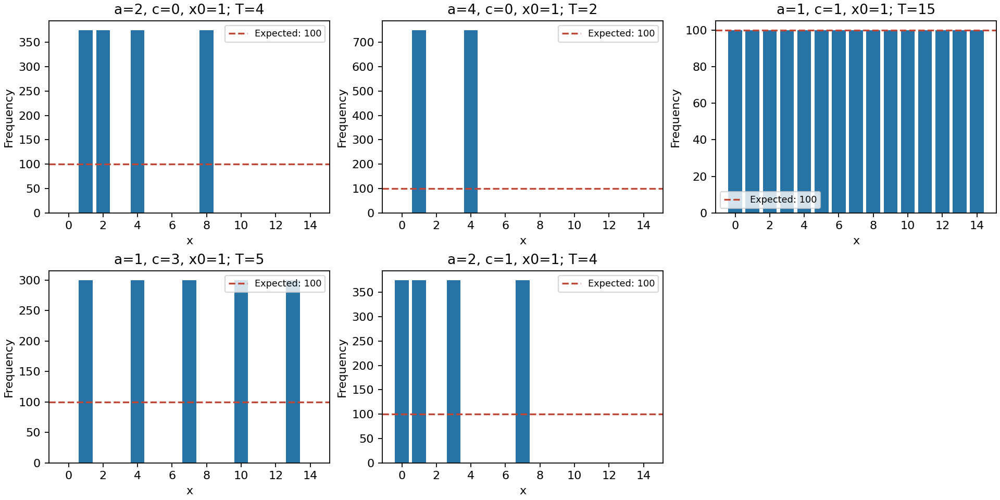

# Лабораторная работа №1. Вариант 6

## Цель и задание
Реализовать линейный конгруэнтный генератор при N=15 в двух режимах: мультипликативном (c=0) и смешанном (c≠0). Подобрать параметры максимального периода, сравнить статистические свойства. Реализовать генерацию кандидатов и проверку тестом Леманна.

## 1. Генератор
Формула: xₜ₊₁=(a·xₜ+c) mod 15. Начальное состояние x₀=1; в выборку входят x₁,…,xₗ.

**Мультипликативный:** a=2, c=0. Цикл: 1→2→4→8→1; T=4. По модулям 3 и 5 максимальные порядки равны 2 и 4, поэтому по модулю 15 максимальный порядок равен НОК(2,4)=4. Для невзаимно простых начальных состояний большего периода также нет; программа дополнительно проверяет максимум полным перебором a=1,…,14 и x₀=0,…,14.

**Смешанный:** a=1, c=1. Условия полного периода: НОД(c,15)=1; a−1 кратно простым делителям 3 и 5. Условие кратности 4 не требуется. В диапазоне 1≤a<15 подходит a=1; T=15. За период встречаются все числа 0,…,14. Это последовательный обход алфавита, а не криптостойкий источник случайности.

## 2. Статистическая проверка
Длина каждой выборки L=1500. Оценки: m=Σxᵢ/L; D=Σ(xᵢ−m)²/L. Для дискретного равномерного распределения на 0,…,14: M=7, D=(15²−1)/12=18.6667.

Частотный критерий: χ²=Σ(fⱼ−L/15)²/(L/15). Гипотеза H₀: все 15 значений равновероятны. Использован порог 23.685 при α=0.05 и 14 степенях свободы. Приложение 2, упомянутое в методичке, не приложено; выбран стандартный частотный критерий Пирсона. Для зависимой детерминированной последовательности это учебная частотная диагностика, не доказательство случайности.

| a | c | Период | Среднее | Дисперсия | χ² |
|---|---|---|---|---|---|
| 2 | 0 | 4 | 3.7500 | 7.1875 | 4125.000 |
| 4 | 0 | 2 | 2.5000 | 2.2500 | 9750.000 |
| 1 | 1 | 15 | 7.0000 | 18.6667 | 0.000 |
| 1 | 3 | 5 | 7.0000 | 18.0000 | 3000.000 |
| 2 | 1 | 4 | 2.7500 | 7.1875 | 4125.000 |



При a=1,c=1 все частоты равны 100, частотная проверка не отвергает равномерность. Остальные наборы дают пропуски символов и отклоняются от равномерности на полном алфавите. Максимальный период мультипликативного режима не обеспечивает равномерность на всех 15 значениях.

## 3. Поиск простых чисел
1. Объединяются 4-битовые записи выходов смешанного ЛКГ. Оставляются p младших битов; старший и младший биты устанавливаются в 1.
2. Кандидат проверяется делением на все простые числа до 256 включительно (последнее — 251). Само малое простое не отбрасывается.
3. Выполняются пять раундов теста Леманна: выбирается 1≤a<n, вычисляется t=a^((n−1)/2) mod n. Если НОД(a,n)≠1 или t не равен 1 либо n−1, число составное. При пяти допустимых остатках и наличии хотя бы одного n−1 число считается вероятно простым. Если все остатки равны 1, результат неопределённый; поиск продолжается.
4. Следующий кандидат n+2. При выходе за p бит поиск возвращается к наименьшему нечётному p-битовому числу. Перебор от начального кандидата прямо разрешён на с.54 методички.

Основания теста выбираются независимо через стандартный secrets.randbelow. ЛКГ используется для начального кандидата. Его период 15 и упаковка цифр не обеспечивают равномерное распределение по всем p-битовым числам. Для фиксированного составного кандидата оценка вероятности прохождения пяти независимых раундов не превышает 2⁻⁵=1/32; это не доказательство простоты и не апостериорная вероятность составности полученного числа.

## 4. Проверки и фактический запуск
Встроенная самопроверка: периоды 4 и 15; полный перебор максимального мультипликативного периода; сравнение с пробным делением для 2,…,300 по всем основаниям; составные 341,561,1105,1729,2465,2821,6601; неопределённый исход при основаниях 1; разрядность и нечётность кандидатов 8,16,32,64,128 бит. Проверки завершились успешно. Три числа из приведённого запуска дополнительно проверены независимой реализацией теста Миллера—Рабина с основаниями 2,325,9375,28178,450775,9780504,1795265022, достаточными для диапазона до 2⁶⁴. Эта проверка выполнена отдельно; основной тест приложения — Леманна.

Результат запуска при L=1500 и p=64; время измерено perf_counter в среде выполнения. При повторном запуске время и результаты вероятностных проверок могут отличаться.

```text
Поиск вероятно простых чисел; тест Леманна, 5 раундов.
n=11764923442565865529; бит=64; кандидатов=20; сито=14; Леманн отклонил=5; неопределённо=0; время=0.000258 с
n=12994706380813107623; бит=64; кандидатов=67; сито=50; Леманн отклонил=16; неопределённо=0; время=0.000471 с
n=14224489319059427893; бит=64; кандидатов=1; сито=0; Леманн отклонил=0; неопределённо=0; время=0.000063 с
Результат вероятностный. Граница ошибки теста: 2^-5 = 1/32.
```

## 5. Ключевые фрагменты

Генератор и формирование битовой записи:
```python
    def next(self):
        self.x = (self.a * self.x + self.c) % N
        return self.x

    def sequence(self, length):
        return [self.next() for _ in range(length)]

    def number(self, bits):
        # Объединяем 4-битовые записи выходов ЛКГ, оставляем bits бит.
        value = 0
        for _ in range((bits + 3) // 4):
            value = (value << 4) | self.next()
        return value & ((1 << bits) - 1)
```

Тест Леманна:
```python
def lehmann(n, rounds=ROUNDS, choose=randbelow):
    # True: вероятно простое; False: составное; None: все остатки равны 1.
    if n in (2, 3):
        return True
    if n < 2 or n % 2 == 0:
        return False
    minus_one = False
    for _ in range(rounds):
        a = 1 + choose(n - 1)  # 1 <= a < n; независимые основания.
        if gcd(a, n) != 1:
            return False
        t = pow(a, (n - 1) // 2, n)
        if t not in (1, n - 1):
            return False
        minus_one |= t == n - 1
    return True if minus_one else None
```

Полный исходный код — main.py, журнал — run.txt.

## Вывод
Реализованы оба режима ЛКГ для N=15 и поиск вероятно простых чисел тестом Леманна. Получены максимальные периоды 4 и 15. Изменение параметров меняет период и частоты; смешанный генератор с a=1,c=1 равномерен за полный период, но предсказуем. Просеивание уменьшает число кандидатов, требующих модульного возведения в степень.
