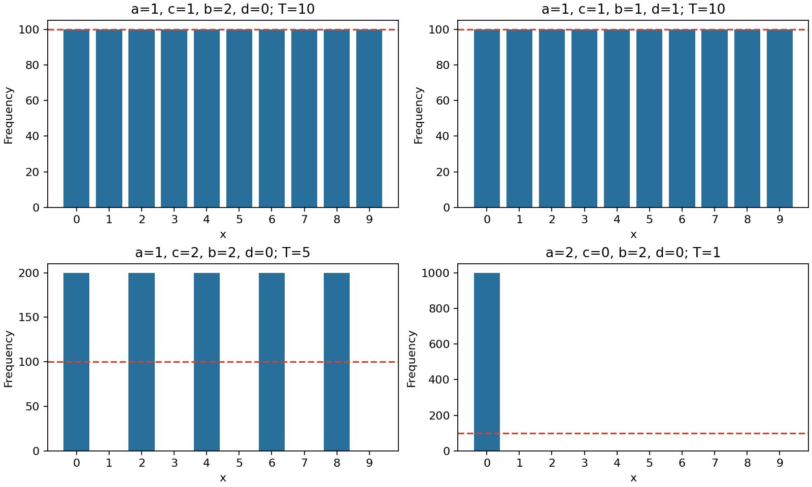

# Лабораторная работа №1. Вариант 1

## Цель и задание
Реализовать комбинирование генераторов методом Макларена—Марсальи с N=10 и K=5, исследовать период и равномерность выходов. На основе генератора формировать кандидатов в простые числа и проверять их тестом Соловея—Штрассена.


## 1. Метод Макларена—Марсальи
В качестве двух простейших генераторов выбраны ЛКГ:

- G₁: xₜ₊₁=(a·xₜ+c) mod 10;
- G₂: yₜ₊₁=(b·yₜ+d) mod 5.

В соответствии с разделом 4.8 (с.38–39) таблица T заполняется первыми пятью значениями x₀,…,x₄. Каждый шаг: s=yₖ; zₖ=T[s]; T[s]=xₖ₊₅. Выдаётся старое значение ячейки, затем она заменяется очередным выходом G₁.

Основные параметры: a=1,c=1,b=1,d=1,x₀=0,y₀=1. Оба базовых ЛКГ имеют полный период: 10 и 5. Условия: приращение взаимно просто с модулем, a−1 (либо b−1) делится на простые делители модуля. Начальная таблица [0,1,2,3,4]; первые восемь выходов [1,2,3,4,0,5,6,7].

Состояние комбинированного генератора включает оба состояния ЛКГ и все пять ячеек таблицы. Для определения периода запоминаются полные состояния до первого повторения. Затем проверяются делители длины циклического блока выходов, чтобы получить минимальный период последовательности.

Для основных параметров хвост состояния равен 5, период состояния и выходов равен 10. Полный перебор 90000 сочетаний a=1..9,c=0..9,b=1..4,d=0..4,x₀=0..9,y₀=0..4 подтвердил максимальный период выходов 10 **в выбранном семействе двух ЛКГ**. Проверка воспроизводится файлом check_periods.py. Это не утверждение о максимуме среди всех возможных видов базовых генераторов. Метод комбинирования не гарантирует увеличения периода для любых параметров.

## 2. Статистическое исследование
Каждая выборка содержит L=1000 выходов, включая начальный участок. Частоты fⱼ подсчитываются для j=0,…,9. Среднее m=Σj·fⱼ/L; дисперсия D=Σ(j−m)²·fⱼ/L. Теоретически для дискретного равномерного распределения: M=4.5, D=(10²−1)/12=8.25.

Критерий Пирсона: χ²=Σ(fⱼ−L/10)²/(L/10). Порог 16.919 при α=0.05 и 9 степенях свободы. H₀ — равные вероятности десяти значений. Для ожидаемой частоты не менее 5 требуется L≥50. Приложение №2 не предоставлено; стандартный частотный критерий выбран согласно требованию README о проверке частот и равномерности. Для зависимых выходов это учебная частотная диагностика, не доказательство случайности или независимости.

| a,c | b,d | Хвост состояния | Период состояния | Период выходов | Среднее | Дисперсия | χ² |
|---|---|---|---|---|---|---|---|
| 1,1 | 2,0 | 4 | 20 | 10 | 4.50 | 8.25 | 0.00 |
| 1,1 | 1,1 | 5 | 10 | 10 | 4.50 | 8.25 | 0.00 |
| 1,2 | 2,0 | 4 | 20 | 5 | 4.00 | 8.00 | 1000.00 |
| 2,0 | 2,0 | 0 | 4 | 1 | 0.00 | 0.00 | 9000.00 |



Два первых набора проходят частотную проверку: каждый символ встречается 100 раз. При c=2 выходы только чётные. При a=2,c=0,x₀=0 первый генератор остаётся в нуле, поэтому все выходы равны нулю. Максимальный период и равные частоты не означают криптостойкость: используемые генераторы имеют короткие, предсказуемые последовательности.

## 3. Кандидаты и тест Соловея—Штрассена
1. Выходы комбинированного генератора записываются 4-битовыми блоками. Оставляются p бит, старший и младший устанавливаются в 1. Это обеспечивает разрядность и нечётность, но не равномерность по всем p-битовым числам.
2. Выполняется деление на все малые простые до 256 (последнее 251). Само малое простое не отбрасывается.
3. Для пяти независимо выбираемых через secrets.randbelow оснований 1≤a<n проверяется НОД(a,n)=1 и сравнение a^((n−1)/2) ≡ J(a,n) (mod n).
4. Нарушение любого условия означает составность. Прохождение пяти раундов означает «вероятно простое». При неудаче берётся n+2; перебор от начального кандидата разрешён на с.54 методички.

Используется символ Якоби J(a,n), определённый и для составных нечётных n. Для простого n он совпадает с символом Лежандра. Это необходимое уточнение обозначения в методичке: простота проверяемого n заранее неизвестна. Отрицательное значение символа приводится по модулю n (−1 превращается в n−1).

Для фиксированного составного кандидата вероятность пройти пять независимых равномерных раундов не превышает 2⁻⁵=1/32. Это не доказательство простоты и не апостериорная вероятность составности полученного результата.

## 4. Проверки и фактический запуск
Встроенная самопроверка проверяет первые восемь выходов вручную заданного примера, период основного генератора, тест простоты для всех чисел 2..300 по всем основаниям в сравнении с точным пробным делением, составные числа 341,561,1105,1729,2465,2821,6601, символ Якоби для малых простых по критерию Эйлера, разрядность и нечётность кандидатов 3,8,16,64,128 бит. Самопроверка и полный перебор периодов выполнены успешно.

Лог реального запуска; время и случайные основания при повторении могут отличаться:

```text
Самопроверка: OK
Длина последовательности [1000]: Разрядность кандидата [64]: 
Макларен—Марсалья: N=10, K=5; x0=0, y0=1.
a=1 c=1 b=2 d=0: хвост состояния=4, период состояния=20, период выходов=10
M=4.5000; D=8.2500; chi2=0.0000; частоты: [100, 100, 100, 100, 100, 100, 100, 100, 100, 100]
H0 не отвергается
a=1 c=1 b=1 d=1: хвост состояния=5, период состояния=10, период выходов=10
M=4.5000; D=8.2500; chi2=0.0000; частоты: [100, 100, 100, 100, 100, 100, 100, 100, 100, 100]
H0 не отвергается
a=1 c=2 b=2 d=0: хвост состояния=4, период состояния=20, период выходов=5
M=4.0000; D=8.0000; chi2=1000.0000; частоты: [200, 0, 200, 0, 200, 0, 200, 0, 200, 0]
H0 отвергается
a=2 c=0 b=2 d=0: хвост состояния=0, период состояния=4, период выходов=1
M=0.0000; D=0.0000; chi2=9000.0000; частоты: [1000, 0, 0, 0, 0, 0, 0, 0, 0, 0]
H0 отвергается
Теория: M=4.5, D=8.25. Порог chi2=16.919; alpha=0.05; df=9.

Тест Соловея—Штрассена: 5 раундов; вероятно простые числа.
n=10535051370564756331; бит=64; кандидатов=20; сито=16; тест отклонил=3; время=0.000243 с
n=16683867545570609413; бит=64; кандидатов=3; сито=2; тест отклонил=0; время=0.000088 с
n=11764923439702558093; бит=64; кандидатов=20; сито=14; тест отклонил=5; время=0.000256 с
```

## 5. Ключевые фрагменты
Шаг комбинирования:
```python
s = self.g2.next()
result = self.table[s]
self.table[s] = self.g1.next()
return result
```
Проверка кандидата:
```python
if gcd(a, n) != 1 or pow(a, (n - 1) // 2, n) != jacobi(a, n) % n:
    return False
```
Полный код — main.py.

## Вывод
Реализованы метод Макларена—Марсальи с N=10,K=5 и тест Соловея—Штрассена. Найдены параметры максимального периода выходов для выбранного семейства базовых ЛКГ. Эксперименты показали влияние параметров на период и частоты. Просеивание уменьшает количество вызовов вероятностного теста.
