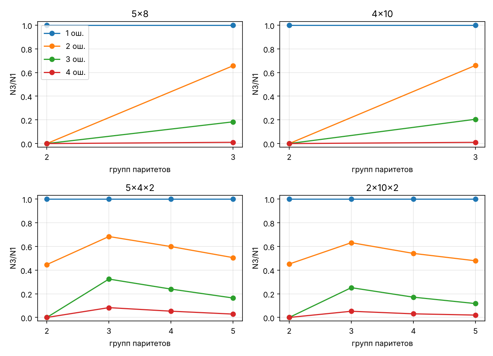

# Лабораторная работа №2. Вариант 10

Избыточное кодирование данных в информационных системах. Часть 1: код Хемминга. Часть 2: итеративные коды.  
Выполнил: студент 4 курса группы АС-65 Чмель Д. А.

## 1. Цель работы

Получить практические навыки кодирования и декодирования двоичных данных кодом Хемминга и итеративными кодами, оценить их корректирующую способность.

## 2. Часть 1. Код Хемминга

### 2.1. Задание

Из текстового файла получить двоичное информационное слово X_k длиной не менее 16 бит, построить проверочную матрицу Хемминга, вычислить избыточные символы X_r, внести 0, 1 и 2 случайные ошибки, вычислить синдром, найти и исправить одиночную ошибку, проанализировать случай двух ошибок. Программа не должна зависеть от длины сообщения. Минимальное кодовое расстояние в задании согласуется с преподавателем, поэтому реализованы оба варианта: d = 3 и d = 4.

### 2.2. Алгоритм

Сообщение читается из файла и переводится в двоичный вид: каждый символ кодируется одним байтом в кодировке Windows-1251 (8 бит). Если сообщение целиком является словом X_k, то k равно числу бит.

Число избыточных символов r - наименьшее целое, при котором 2^r >= k + r + 1. Проверочная матрица имеет вид H = [P' | I], где I - единичная матрица r x r, а столбцы P' - различные ненулевые двоичные векторы длины r, вес которых не меньше 2. Векторы берутся в порядке возрастания веса, а при равном весе в порядке возрастания числового значения (3, 5, 6, 9, ...), первые k штук.

Для d = 4 к матрице добавляется строка общей проверки на четность и столбец (0, ..., 0, 1). Затем матрица приводится к каноническому виду: последняя строка заменяется суммой всех строк. На практике это значит, что к каждому столбцу P' добавляется элемент 1 + вес столбца (mod 2). Все столбцы получаются нечетного веса, поэтому сумма двух столбцов никогда не равна третьему столбцу.

Избыточные символы: X_r[i] равен сумме по модулю 2 тех символов X_k, в столбцах которых в i-й строке P' стоит 1. Кодовое слово X_n = X_k, X_r. Для принятого слова Y_n = Y_k, Y_r избыточные символы Y_r' вычисляются заново по Y_k, а синдром S = Y_r + Y_r' (то же самое, что H * Y_n^T). Если S = 0, ошибок не обнаружено. Если S совпадает со столбцом H с номером j, ошибка в позиции j: формируется унарный вектор E_n и исправленное слово Y_n + E_n. Если S ненулевой, но не совпадает ни с одним столбцом, ошибка обнаружена, но исправить ее нельзя.

### 2.3. Реализация

Программа hamming.py запускается командой:

```text
python hamming.py input.txt -d 3 -e 1 -k 24 -s 1 -o result.txt
```

Параметры: d - минимальное расстояние (3 или 4), e - число ошибок (0, 1, 2), k - длина слова в битах (по умолчанию все сообщение), s - начальное значение генератора случайных чисел, o - файл для результата. Позиции ошибок выбираются случайно среди всех n символов слова, включая избыточные. В файл и на экран выводятся сообщение, k, r, n, матрица H, слова X_k, X_r, X_n, Y_n, Y_r, Y_r', синдром S и вектор ошибки E_n.

*Листинг 1 - Построение матрицы, кодирование и декодирование*

```text
def build_matrix(k, d=3):
    r = calc_r(k)
    nums = sorted((n for n in range(3, 2 ** r) if n & (n - 1)),
                  key=lambda n: (bin(n).count("1"), n))
    cols = [[(n >> (r - 1 - i)) & 1 for i in range(r)] for n in nums[:k]]
    if d == 4:
        cols = [c + [1 - sum(c) % 2] for c in cols]
        r += 1
    return [[c[i] for c in cols] + [int(i == j) for j in range(r)] for i in range(r)]

def encode(xk, H):
    k = len(xk)
    return [sum(h & x for h, x in zip(row[:k], xk)) % 2 for row in H]

def decode(y, H, k, table=None):
    table = table or syndrome_table(H)
    yr = y[k:]
    yr2 = encode(y[:k], H)
    s = [a ^ b for a, b in zip(yr, yr2)]
    res = {"yr": yr, "yr2": yr2, "s": s, "pos": None, "e": [0] * len(y), "y": y[:]}
    if not any(s):
        res["status"] = "none"
        return res
    pos = table.get(tuple(s))
    if pos is None:
        res["status"] = "detected"
        return res
    res["status"] = "corrected"
    res["pos"] = pos
    res["e"][pos] = 1
    res["y"][pos] ^= 1
    return res
```

### 2.4. Примеры работы

Исходное сообщение «Код» (k = 24, три символа в Windows-1251). Для d = 3 получается r = 5, n = 29, для d = 4 - r = 6, n = 30.

*Листинг 2 - d = 3, ошибок нет*

```text
Сообщение: Код
Информационное слово X_k: 110010101110111011100100
k = 24, r = 5, n = 29, d_min = 3
Проверочная матрица H:
  00000011110000111111011110000
  00011100010111000111101101000
  01100100101011011001110100100
  10101001001101101010111000010
  11010010001110110100111100001
Избыточные символы X_r: 00100
Кодовое слово X_n: 11001010111011101110010000100
Позиции ошибок (с 1): нет
Принятое слово Y_n: 11001010111011101110010000100
Y_r: 00100
Y_r': 00100
Синдром S: 00000
Синдром нулевой, ошибок не обнаружено
```

*Листинг 3 - d = 3, одна ошибка*

```text
Сообщение: Код
Информационное слово X_k: 110010101110111011100100
k = 24, r = 5, n = 29, d_min = 3
Проверочная матрица H:
  00000011110000111111011110000
  00011100010111000111101101000
  01100100101011011001110100100
  10101001001101101010111000010
  11010010001110110100111100001
Избыточные символы X_r: 00100
Кодовое слово X_n: 11001010111011101110010000100
Позиции ошибок (с 1): [20]
Принятое слово Y_n: 11001010111011101111010000100
Y_r: 00100
Y_r': 11000
Синдром S: 11100
Синдром совпал со столбцом 20
Вектор ошибки E_n: 00000000000000000001000000000
Исправленное слово: 11001010111011101110010000100
Результат: слово восстановлено
```

*Листинг 4 - d = 3, две ошибки*

```text
Сообщение: Код
Информационное слово X_k: 110010101110111011100100
k = 24, r = 5, n = 29, d_min = 3
Проверочная матрица H:
  00000011110000111111011110000
  00011100010111000111101101000
  01100100101011011001110100100
  10101001001101101010111000010
  11010010001110110100111100001
Избыточные символы X_r: 00100
Кодовое слово X_n: 11001010111011101110010000100
Позиции ошибок (с 1): [9, 16]
Принятое слово Y_n: 11001010011011111110010000100
Y_r: 00100
Y_r': 00101
Синдром S: 00001
Синдром совпал со столбцом 29
Вектор ошибки E_n: 00000000000000000000000000001
Исправленное слово: 11001010011011111110010000101
Результат: слово восстановлено неверно
```

*Листинг 5 - d = 4, одна ошибка*

```text
Сообщение: Код
Информационное слово X_k: 110010101110111011100100
k = 24, r = 6, n = 30, d_min = 4
Проверочная матрица H:
  000000111100001111110111100000
  000111000101110001111011010000
  011001001010110110011101001000
  101010010011011010101110000100
  110100100011101101001111000010
  111111111100000000001111000001
Избыточные символы X_r: 001001
Кодовое слово X_n: 110010101110111011100100001001
Позиции ошибок (с 1): [20]
Принятое слово Y_n: 110010101110111011110100001001
Y_r: 001001
Y_r': 110001
Синдром S: 111000
Синдром совпал со столбцом 20
Вектор ошибки E_n: 000000000000000000010000000000
Исправленное слово: 110010101110111011100100001001
Результат: слово восстановлено
```

*Листинг 6 - d = 4, две ошибки*

```text
Сообщение: Код
Информационное слово X_k: 110010101110111011100100
k = 24, r = 6, n = 30, d_min = 4
Проверочная матрица H:
  000000111100001111110111100000
  000111000101110001111011010000
  011001001010110110011101001000
  101010010011011010101110000100
  110100100011101101001111000010
  111111111100000000001111000001
Избыточные символы X_r: 001001
Кодовое слово X_n: 110010101110111011100100001001
Позиции ошибок (с 1): [5, 11]
Принятое слово Y_n: 110000101100111011100100001001
Y_r: 001001
Y_r': 010010
Синдром S: 011011
Синдром не совпадает ни с одним столбцом H: обнаружена ошибка, исправление невозможно
```

В примере с d = 3 и двумя ошибками (позиции 9 и 16) синдром совпал со столбцом 29, декодер изменил 29-й символ, и слово восстановлено неверно: получилось слово с тремя ошибками. При d = 4 синдром двух ошибок имеет четный вес, ни с одним столбцом не совпадает, и ошибка только обнаруживается.

### 2.5. Эксперимент

Методика. Для каждой длины k берется начало сообщения из файла input.txt (192 символа). Для каждого d по 2000 раз вносится 1 ошибка и по 2000 раз - 2 ошибки в случайные позиции слова X_n, затем слово декодируется. Подсчитывается, сколько раз слово исправлено верно, исправлено неверно и сколько раз ошибка только обнаружена.

*Таблица 1 - Результаты декодирования кодом Хемминга*

| k | r | n | d | k/n | 1 ошибка, исправлено, % | 2 ошибки, исправлено неверно, % | 2 ошибки, обнаружено, % |
|---|---|---|---|---|---|---|---|
| 16 | 5 | 21 | 3 | 0.762 | 100.0 | 70.0 | 30.0 |
| 16 | 6 | 22 | 4 | 0.727 | 100.0 | 0.0 | 100.0 |
| 24 | 5 | 29 | 3 | 0.828 | 100.0 | 93.3 | 6.7 |
| 24 | 6 | 30 | 4 | 0.800 | 100.0 | 0.0 | 100.0 |
| 64 | 7 | 71 | 3 | 0.901 | 100.0 | 62.4 | 37.6 |
| 64 | 8 | 72 | 4 | 0.889 | 100.0 | 0.0 | 100.0 |
| 256 | 9 | 265 | 3 | 0.966 | 100.0 | 62.0 | 38.0 |
| 256 | 10 | 266 | 4 | 0.962 | 100.0 | 0.0 | 100.0 |
| 1024 | 11 | 1035 | 3 | 0.989 | 100.0 | 56.9 | 43.1 |
| 1024 | 12 | 1036 | 4 | 0.988 | 100.0 | 0.0 | 100.0 |

Одиночная ошибка исправляется во всех случаях при любом k и любом d. При d = 3 две ошибки не обнаруживаются как две: синдром равен сумме двух столбцов, которая либо совпадает с третьим столбцом (слово исправляется неверно), либо не совпадает ни с одним (ошибка обнаружена). Какая доля двойных ошибок обнаруживается, зависит от того, сколько из 2^r - 1 возможных ненулевых синдромов занято столбцами H: при k = 24 это 29 из 31, и почти все двойные ошибки исправляются неверно (93 %), при k = 16 - 21 из 31 (обнаруживается 30 %), при k = 1024 - 1035 из 2047 (обнаруживается 43 %). При d = 4 все двойные ошибки обнаруживаются. Цена за это один дополнительный избыточный символ; при росте k избыточность быстро падает (k/n для k = 1024: 0,989 при d = 3 и 0,988 при d = 4).

Время работы и размер матрицы растут линейно с k (матрица r x n, r порядка log2 k), на сообщениях длиной до 1024 бит программа работает без изменений.

## 3. Часть 2. Итеративные коды

### 3.1. Задание

Реализовать приложение, которое записывает информационное слово длиной k бит в двумерную или трехмерную матрицу, вычисляет проверочные биты по 2, 3, 4 направлениям (группам паритетов), формирует кодовое слово X_n, вносит ошибку произвольной кратности, определяет положение ошибочных символов, исправляет их и оценивает корректирующую способность: отношения N2/N1 и N3/N1, где N1 - число кодовых слов с ошибкой заданной кратности, N2 - число случаев, когда кратность определена верно, N3 - число случаев, когда все ошибки исправлены.

Используется вариант 5 из таблицы 5.2 методических указаний: k = 40.

*Таблица 2 - Конфигурации варианта 5*

| Конфигурация | k1 | k2 | z | Группы паритетов |
|---|---|---|---|---|
| 1 | 5 | 8 | - | 2; 3 |
| 2 | 4 | 10 | - | 2; 3 |
| 3 | 5 | 4 | 2 | 2; 3; 4; 5 |
| 4 | 2 | 10 | 2 | 2; 3; 4; 5 |

### 3.2. Алгоритм

Информационное слово записывается в массив размера k1 x k2 x z по плоскостям, затем по строкам. Проверка на четность вычисляется по линиям, объединенным в группы. Группы добавляются по порядку:

- 1 - горизонтальные: по каждой строке каждой плоскости;
- 2 - вертикальные: по каждому столбцу каждой плоскости;
- 3 - диагональные: по линиям i - j = const в каждой плоскости (k1 + k2 - 1 линий);
- 4 - обратные диагональные: по линиям i + j = const в каждой плоскости;
- 5 - по оси z: по каждой паре (i, j) через все плоскости.
Число групп, указанное в варианте, означает, что используются первые g групп из этого списка. Для двумерных конфигураций (z = 1) допустимы 2 и 3 группы, для трехмерных - от 2 до 5. Избыточное слово X_r составляется из проверочных битов групп по порядку, X_n = X_k, X_r.

Декодирование. Для принятого слова Y_n повторно вычисляются проверки по информационной части и сравниваются с принятыми проверочными битами; несовпавшие проверки называются нарушенными. Информационный бит считается ошибочным, если нарушены все проверки, в которые он входит. Если такой бит один или каждая его проверка не принадлежит другому такому биту, он исправляется. Если кандидатов нет и нарушена ровно одна проверка, ошибочным считается проверочный бит этой проверки. Процесс повторяется, пока нарушенных проверок не останется. Если очередной шаг однозначно выбрать нельзя (например, кандидаты образуют вершины прямоугольника), декодирование останавливается: ошибки обнаружены, но не исправлены.

### 3.3. Реализация

Программа iterative.py. Запуск одного кодирования с ошибками:

```text
python iterative.py -v 5 -c 1 -g 3 -e 2 -s 4
```

Параметры: v - вариант, c - номер конфигурации, g - число групп паритетов, e - кратность ошибки, b - информационное слово (если не задано, генерируется случайно), s - начальное значение генератора случайных чисел. Режим --stat запускает эксперимент оценки корректирующей способности.

*Листинг 7 - Формирование проверок, кодирование и декодирование*

```text
    def group_checks(self, g):
        k1, k2, z = self.k1, self.k2, self.z
        res = []
        if g == 0:
            for p in range(z):
                for i in range(k1):
                    res.append([self.idx(p, i, j) for j in range(k2)])
        elif g == 1:
            for p in range(z):
                for j in range(k2):
                    res.append([self.idx(p, i, j) for i in range(k1)])
        elif g == 2:
            for p in range(z):
                for d in range(k1 + k2 - 1):
                    res.append([self.idx(p, i, j) for i in range(k1) for j in range(k2)
                                if i - j + k2 - 1 == d])
        elif g == 3:
            for p in range(z):
                for s in range(k1 + k2 - 1):
                    res.append([self.idx(p, i, j) for i in range(k1) for j in range(k2)
                                if i + j == s])
        else:
            for i in range(k1):
                for j in range(k2):
                    res.append([self.idx(p, i, j) for p in range(z)])
        return res

    def encode(self, xk):
        return xk + [sum(xk[x] for x in cells) % 2 for cells in self.checks]

    def failed(self, y):
        return {c for c, cells in enumerate(self.checks)
                if (sum(y[x] for x in cells) + y[self.k + c]) % 2}

    def decode(self, y):
        y = y[:]
        flips = []
        while len(flips) <= self.n:
            f = self.failed(y)
            if not f:
                return y, flips, True
            cand = [x for x in range(self.k) if f.issuperset(self.cover[x])]
            cnt = Counter(c for x in cand for c in self.cover[x])
            sure = [x for x in cand if all(cnt[c] == 1 for c in self.cover[x])]
            if sure:
                pos = sure
            elif not cand and len(f) == 1:
                pos = [self.k + next(iter(f))]
            else:
                break
            for p in pos:
                y[p] ^= 1
            flips += pos
        return y, flips, False
```

### 3.4. Примеры работы

Конфигурация 5 x 8 (k = 40), три группы паритетов: r = 5 + 8 + 12 = 25, n = 65. Проверки пронумерованы подряд: 1 - 5 горизонтальные, 6 - 13 вертикальные, 14 - 25 диагональные.

*Листинг 8 - одна ошибка*

```text
k1 = 5, k2 = 8, z = 1, групп паритетов: 3
k = 40, r = 25, n = 65
Информационное слово X_k: 0110011100110010101111110110101100000110
  паритеты (горизонтальные): 11110
  паритеты (вертикальные): 10000111
  паритеты (диагональные): 111000111000
Кодовое слово X_n: 01100111001100101011111101101011000001101111010000111111000111000
Позиции ошибок (с 1): [31]
Принятое слово Y_n: 01100111001100101011111101101001000001101111010000111111000111000
Нарушенные проверки: [4, 12, 18]
Исправлены позиции: [31]
Слово после исправления Y_n': 01100111001100101011111101101011000001101111010000111111000111000
Результат: слово восстановлено
```

*Листинг 9 - две ошибки*

```text
k1 = 5, k2 = 8, z = 1, групп паритетов: 3
k = 40, r = 25, n = 65
Информационное слово X_k: 0110011100110010101111110110101100000110
  паритеты (горизонтальные): 11110
  паритеты (вертикальные): 10000111
  паритеты (диагональные): 111000111000
Кодовое слово X_n: 01100111001100101011111101101011000001101111010000111111000111000
Позиции ошибок (с 1): [4, 51]
Принятое слово Y_n: 01110111001100101011111101101011000001101111010000011111000111000
Нарушенные проверки: [1, 9, 11, 18]
Исправлены позиции: [4, 51]
Слово после исправления Y_n': 01100111001100101011111101101011000001101111010000111111000111000
Результат: слово восстановлено
```

*Листинг 10 - три ошибки*

```text
k1 = 5, k2 = 8, z = 1, групп паритетов: 3
k = 40, r = 25, n = 65
Информационное слово X_k: 0110011100110010101111110110101100000110
  паритеты (горизонтальные): 11110
  паритеты (вертикальные): 10000111
  паритеты (диагональные): 111000111000
Кодовое слово X_n: 01100111001100101011111101101011000001101111010000111111000111000
Позиции ошибок (с 1): [3, 10, 21]
Принятое слово Y_n: 01000111011100101011011101101011000001101111010000111111000111000
Нарушенные проверки: [1, 2, 3, 7, 8, 10, 21]
Ошибки обнаружены, однозначно исправить не удалось
```

В третьем примере ошибки в позициях 3 и 21 лежат на одной диагонали и гасят друг друга в диагональной проверке. Среди кандидатов появляется ложный, и однозначно выбрать нельзя: код только обнаруживает ошибку.

### 3.5. Эксперимент

Методика. Для каждой конфигурации и каждого числа групп 3000 раз генерируется случайное информационное слово, кодируется, затем в случайные различные позиции всего слова X_n (включая проверочные биты) вносится i ошибок, i = 1, ..., 4, и слово декодируется. N2 увеличивается, если декодирование завершилось с нулевым синдромом и число исправленных символов равно i, N3 - если исправленное слово совпадает с X_n.

*Таблица 3 - Отношения N2/N1 и N3/N1*

| Конфигурация | Групп | r | n | k/n | i = 1 | i = 2 | i = 3 | i = 4 |
|---|---|---|---|---|---|---|---|---|
| 5x8 | 2 | 13 | 53 | 0.75 | 1.000 | 0.000 | 0.000 | 0.000 |
| 5x8 | 3 | 25 | 65 | 0.62 | 1.000 | 0.657 | 0.184 | 0.011 |
| 4x10 | 2 | 14 | 54 | 0.74 | 1.000 | 0.000 | 0.000 | 0.000 |
| 4x10 | 3 | 27 | 67 | 0.60 | 1.000 | 0.660 | 0.205 | 0.010 |
| 5x4x2 | 2 | 18 | 58 | 0.69 | 1.000 | 0.447 | 0.000 | 0.000 |
| 5x4x2 | 3 | 34 | 74 | 0.54 | 1.000 | 0.684 | 0.324 | 0.083 |
| 5x4x2 | 4 | 50 | 90 | 0.44 | 1.000 | 0.599 | 0.240 | 0.053 |
| 5x4x2 | 5 | 70 | 110 | 0.36 | 1.000 | 0.505 | 0.164 | 0.028 |
| 2x10x2 | 2 | 24 | 64 | 0.62 | 1.000 | 0.451 | 0.000 | 0.000 |
| 2x10x2 | 3 | 46 | 86 | 0.47 | 1.000 | 0.632 | 0.252 | 0.052 |
| 2x10x2 | 4 | 68 | 108 | 0.37 | 1.000 | 0.541 | 0.171 | 0.031 |
| 2x10x2 | 5 | 88 | 128 | 0.31 | 1.000 | 0.479 | 0.117 | 0.020 |

Во всех опытах N2 совпало с N3, поэтому в таблице дано одно значение. Это означает, что если декодер завершал работу с нулевым синдромом и исправлял ровно i символов, то эти символы были ошибочными.



*Рисунок 1 - Доля полностью исправленных слов N3/N1*

Результаты:

- Одиночные ошибки исправляются всегда (N3/N1 = 1) при любом числе групп, в том числе ошибки в проверочных битах.
- Две группы паритетов в двумерной матрице не исправляют двойные ошибки: две ошибки образуют вершины прямоугольника кандидатов, и однозначно выбрать нельзя. В трехмерных конфигурациях при двух группах результат 0,45 получается за счет ошибок, попавших в разные плоскости.
- Третья группа (диагонали) заметно повышает долю исправленных двойных ошибок: 0,66 для 5x8 и 4x10, 0,68 для 5x4x2, 0,63 для 2x10x2. Тройные ошибки исправляются в 18 - 32 % случаев, четверные редко (1 - 8 %).
- Дальнейшее добавление групп (4 и 5) для трехмерных кодов результат не улучшает, а ухудшает: растет число проверочных битов, и случайные ошибки чаще попадают на них; при этом падает скорость кода (для 5x4x2 с 5 группами k/n = 0,36).
Для сравнения: код Хемминга для k = 40 имеет r = 6, n = 46, k/n = 0,87 и исправляет одиночные ошибки гарантированно, тогда как итеративный код с тремя группами 5x8 при k/n = 0,62 исправляет одиночные ошибки и две из трех двойных. Основное достоинство итеративных кодов - простота кодирования и декодирования, недостаток - высокая избыточность.

## 4. Проверка программ

Для проверки написаны модульные тесты (python -m unittest test_lab2). Проверяются: значения r для известных k; различимость и ненулевость столбцов H, нечетный вес столбцов при d = 4; нулевой синдром кодового слова; исправление одиночной ошибки в каждой из n позиций при d = 3 и d = 4; обнаружение всех двойных ошибок при d = 4; перевод текста в биты; размеры итеративного кода; исправление одиночной ошибки в каждой позиции для всех конфигураций всех пяти вариантов таблицы 5.2 и всех допустимых чисел групп; отсутствие ошибок; четыре ошибки в вершинах прямоугольника при двух группах не дают нарушенных проверок (ошибка не обнаруживается), как описано в методических указаниях.

*Листинг 11 - Результат запуска тестов*

```text
test_codeword_syndrome_zero (test_lab2.HammingTest.test_codeword_syndrome_zero) ... ok
test_double_error_extended (test_lab2.HammingTest.test_double_error_extended) ... ok
test_matrix (test_lab2.HammingTest.test_matrix) ... ok
test_r (test_lab2.HammingTest.test_r) ... ok
test_single_error_every_position (test_lab2.HammingTest.test_single_error_every_position) ... ok
test_text_bits (test_lab2.HammingTest.test_text_bits) ... ok
test_no_errors (test_lab2.IterativeTest.test_no_errors) ... ok
test_rectangle_not_detected (test_lab2.IterativeTest.test_rectangle_not_detected) ... ok
test_single_error_all_configs (test_lab2.IterativeTest.test_single_error_all_configs) ... ok
test_size (test_lab2.IterativeTest.test_size) ... ok

----------------------------------------------------------------------
Ran 10 tests in 0.138s

OK
```

## 5. Выводы

- Код Хемминга с d = 3 исправляет любую одиночную ошибку, но при двух ошибках либо исправляет слово неверно, либо лишь обнаруживает ошибку. Расширение до d = 4 стоит одного проверочного символа и позволяет обнаруживать все двойные ошибки.
- Избыточность кода Хемминга растет как log2 k, поэтому для длинных сообщений он эффективнее итеративных кодов, у которых число проверочных битов пропорционально размерам матрицы.
- Итеративные коды просты в реализации и исправляют часть кратных ошибок, но корректирующая способность зависит от расположения ошибок, а не только от их числа; ошибки в вершинах прямоугольника при двух группах паритетов не обнаруживаются совсем.
- Увеличение числа групп паритетов выше трех в проведенном эксперименте не повысило долю исправленных слов, но снизило скорость кода.
