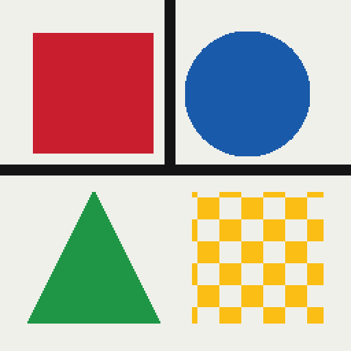
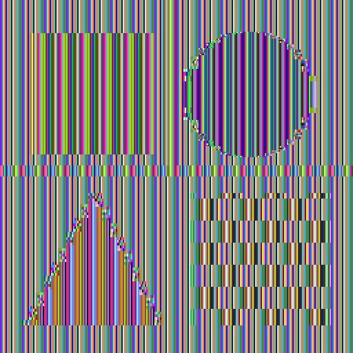

# Лабораторная работа №3 — вариант 12

ФИО: Осовец Арсений Олегович  
Группа: АС-66

## Постановка задачи

Вариант 12: блочный шифр **СТБ 34.101.31 («БелТ»)**, режимы **ECB + OFB**. Особенность варианта: оптимизация предварительной генерации псевдослучайной гаммы для OFB.

Требуется реализовать шифр без сторонних криптографических библиотек, режимы ECB и OFB для сообщений произвольной длины, а также дополнение PKCS#7. Нужно показать работу паддинга и уязвимость ECB на изображении.

## Теоретическая часть

### Шифр БелТ

Блок 128 бит разбивается на слова `a, b, c, d` по 32 бита (порядок байт little-endian). Ключ 256 бит разбивается на слова `K1…K8`. Раундовые ключи берутся по циклу: `k[i] = K[(i−1) mod 8 + 1]`, `i = 1…56`.

`G_r(u) = RotHi^r(H(u1) ‖ H(u2) ‖ H(u3) ‖ H(u4))`, `r ∈ {5, 13, 21}`. Здесь `H` — фиксированная подстановка байт, а `RotHi^r` — циклический сдвиг влево на `r` бит. `⊞` и `⊟` — сложение и вычитание по модулю 2³².

Раунд `i = 1…8` использует ключи `k[7i−6] … k[7i]`:

```
1) b ← b ⊕ G5(a ⊞ k[7i−6])        6) c ← c ⊟ e
2) c ← c ⊕ G21(d ⊞ k[7i−5])       7) d ← d ⊞ G13(c ⊞ k[7i−2])
3) a ← a ⊟ G13(b ⊞ k[7i−4])       8) b ← b ⊕ G21(a ⊞ k[7i−1])
4) e ← G21(b ⊞ c ⊞ k[7i−3]) ⊕ ⟨i⟩  9) c ← c ⊕ G5(d ⊞ k[7i])
5) b ← b ⊞ e                      10–12) a ↔ b, c ↔ d, b ↔ c
```

Результат: `Y = b ‖ d ‖ a ‖ c`. При расшифровании раунды идут с `i = 8` до `1`, ключи в каждом раунде берутся в обратном порядке. Последняя перестановка `a ↔ d`, результат `X = c ‖ a ‖ d ‖ b`.

### Режимы

- **ECB:** `C_i = E_K(P_i)`, `P_i = D_K(C_i)`. Блоки независимы, поэтому одинаковые блоки текста дают одинаковые блоки шифротекста. Нужен паддинг.
- **OFB:** `I_0 = IV`, `I_i = E_K(I_{i−1})`, `C_i = P_i ⊕ I_i`, `P_i = C_i ⊕ I_i`. Получается синхронный потоковый шифр. Гамма зависит только от `K` и `IV`, а для расшифрования тоже нужна только `E_K`. Паддинг не нужен: неполный последний блок складывается с началом `I_N`.

### PKCS#7

Добавляется `k = B − (L mod B)` байт со значением `k`, где `B = 16` и `1 ≤ k ≤ 16`. Если длина кратна 16, добавляется целый блок `10…10`. При снятии проверяется, что `1 ≤ k ≤ 16` и что последние `k` байт равны `k`.

## Архитектура программы

| Файл | Назначение |
|------|-----------|
| `belt.py` | **Модуль 1 — блочный шифр.** H-блок, `G_r`, развёртка ключа, `encrypt_block(pt_block, key)` / `decrypt_block(ct_block, key)` строго по формулам стандарта. Класс `BeltCipher` — та же функция с ключом, развёрнутым один раз, и табличными G. |
| `modes.py` | **Модуль 2 — режимы.** `pkcs7_pad` / `pkcs7_unpad`, `ecb_encrypt` / `ecb_decrypt`, `OfbGamma` (генератор гаммы с предвычислением), `ofb_encrypt` / `ofb_decrypt`, наивный `ofb_encrypt_naive` для сравнения. Модуль использует только блочные функции модуля 1. |
| `main.py` | Демонстрация и исследование: контрольные примеры, строки, паддинг, свойства OFB, ошибка в одном бите, изображение, бенчмарк гаммы. Вывод дублируется в `lab3_output.txt`. |
| `tests.py` | Модульные тесты (`unittest`). |
| `images/` | Исходное изображение и результаты шифрования в ECB и OFB (BMP + увеличенные PNG). |
| `sample_output.txt` | Контрольный вывод программы. |

## Оптимизация гаммы OFB (особенность варианта)

1. **Предвычисление.** Гамма не зависит от данных. Это проверяется в программе: `C ⊕ P` для разных текстов совпадает. Поэтому `OfbGamma.precompute(n)` вырабатывает её заранее, «офлайн». Когда данные приходят, остаётся одна операция XOR. Гамму можно выдавать порциями (`take`), недостающее дорабатывается дальше по той же цепочке.
2. **Ключ разворачивается один раз** (`BeltCipher`), а не на каждом блоке.
3. **Табличная G.** `RotHi` линеен относительно XOR, поэтому `G_r(u) = T0[u0] ⊕ T1[u1] ⊕ T2[u2] ⊕ T3[u3]`. Двенадцать таблиц по 256 слов строятся один раз, и на каждую G приходится 4 обращения к таблицам вместо подстановки и сдвига.
4. **Состояние в словах.** `I_{i−1}` хранится как 4 целых, без перевода в байты между итерациями.
5. **XOR одной операцией** над длинными целыми (`int.from_bytes`) вместо побайтового цикла.

Цепочка `I_i = E_K(I_{i−1})` строго последовательная: в отличие от CTR, её нельзя распараллелить. Зато её можно убрать с критического пути.

## Результаты

Полный вывод — в [`sample_output.txt`](sample_output.txt).

- **Контрольные примеры СТБ 34.101.31, прил. А:** A.1 (зашифрование) и A.4 (расшифрование) совпадают для эталонной и быстрой реализаций.
- **Тестовые строки** (латиница, кириллица, UTF-8) и 300 случайных сообщений длиной 0–99 байт со случайными `K` и `IV` расшифровываются верно. Наивный и оптимизированный OFB дают одинаковый шифротекст.
- **Паддинг:**

  | L, байт | k | ECB, байт | OFB, байт |
  |---|---|---|---|
  | 0 | 16 | 16 | 0 |
  | 5 | 11 | 16 | 5 |
  | 15 | 1 | 16 | 15 |
  | 16 | 16 | 32 | 16 |
  | 17 | 15 | 32 | 17 |
  | 32 | 16 | 48 | 32 |

  Некорректный паддинг (`00`, `11`, `03 04 04 04`, длина не кратна 16, пустой ввод, искажённый шифротекст) отклоняется с одной общей ошибкой.
- **Ошибка в одном бите шифротекста:** в ECB искажается весь блок (≈60 бит из 128). В OFB меняется ровно один бит открытого текста.
- **Изображение 256×256** (12 288 блоков пикселей, заголовок BMP оставлен открытым):

  | | повторяющихся блоков |
  |---|---|
  | исходное | 12 210 |
  | ECB | 12 210 |
  | OFB | 0 |

  | Исходное | ECB | OFB |
  |---|---|---|
  |  |  |  |

- **Бенчмарк OFB** (Python 3.9, Apple Silicon, лучшее из 3 запусков):

  | Объём | A: наивный, с | B: оптимизированный, с | C: офлайн, с | C: онлайн (XOR), мс |
  |---|---|---|---|---|
  | 16 КиБ | 0,025 | 0,013 | 0,012 | 0,018 |
  | 64 КиБ | 0,100 | 0,050 | 0,049 | 0,073 |
  | 256 КиБ | 0,397 | 0,200 | 0,198 | 0,289 |
  | 1 МиБ | 1,609 | 0,803 | 0,800 | 1,213 |

  Развёртка ключа один раз, табличные G и XOR одной операцией ускоряют OFB в 2 раза. С предвычисленной гаммой «онлайн»-часть (сам XOR) быстрее наивной реализации примерно в 1300 раз: шифр в ней вообще не участвует.

## Выводы

ECB не скрывает структуру данных: на изображении остаются контуры фигур, а число повторяющихся блоков не меняется. OFB даёт шум без повторов, не требует паддинга, не размножает ошибки передачи и использует только `E_K`. Однако повтор `IV` при том же ключе недопустим: `C1 ⊕ C2 = P1 ⊕ P2`. Выработка гаммы OFB последовательна, но не зависит от данных, поэтому её выгодно делать заранее. Тогда шифрование сводится к XOR.

## Запуск

Нужен Python 3.8+, сторонние библиотеки не используются.

```bash
cd lab3/src/variant_12
python3 main.py            # полный прогон (бенчмарк 16, 64, 256, 1024 КиБ), ~12 с
python3 main.py 64         # бенчмарк только на 64 КиБ
python3 -m unittest tests.py
```

## Что сдавать

Работа лежит в личном форке, в ветке `lab-3-asavets`. Pull Request: `[Лаб 3] Осовец Арсений — Вариант 12` в `main` основного репозитория. Отчёт — `lab3/rep/variant_12/Лаб3.pdf`.
